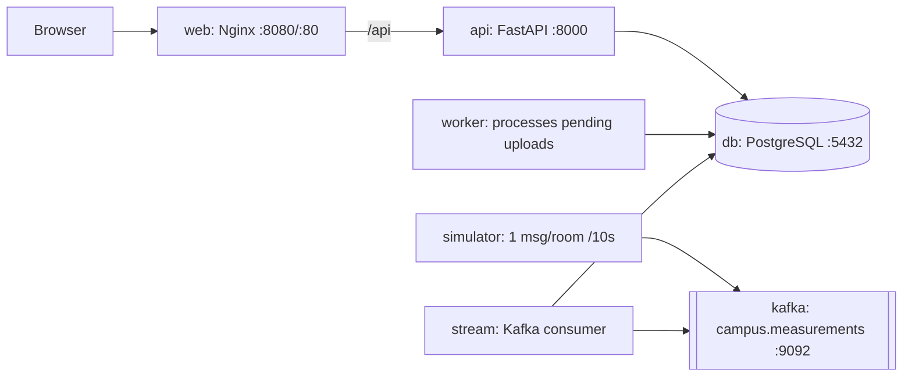
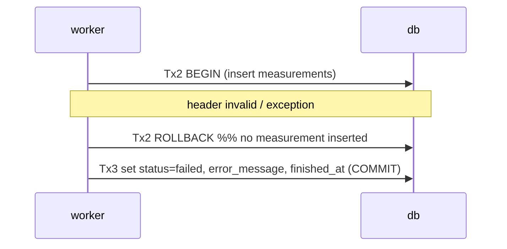

# Design file - team to fill in

**Members:** _(to fill in — names of the pair)_. **File version / commit:** _(to fill in — short git SHA)_.
**Review date:** _(to fill in)_. **Reviewer:** _(to fill in — the pair that reviewed us in step 8)_.

This template is filled in from S1 and then evolves with the decisions actually made.
Replace the instructions with your answers; keep the useful limits.
Do not copy the whole assignment: explain how it applies to your work.


## 1. Need and users

1. **User.** The campus **data team** uses CampusData; it is an internal tool, not a public website, and no one logs in.
2. **Problem.** Today sensor measurements are copied by hand into a spreadsheet, which produces typing errors and duplicate rows.
3. **Main action.** A team member creates a dataset, uploads a CSV file (or lets the Kafka stream fill a stream dataset), then reads the per-room indicators.
4. **Durable data.** Datasets, uploads (with their outcome) and the validated measurements are stored in PostgreSQL and survive a restart.
5. **Prototype limit.** No authentication, no AI and no real sensors (a simulator plays them); the dataset `owner` is a free-text label, **not an authenticated account**.

**Demo journey (happy path).** Create dataset "Air quality - building A" → upload `room-measurements-2026-10-05.csv` → the upload goes `pending` then `succeeded` with 63 accepted / 0 rejected / 0 duplicate → open the dataset and read CO₂ average, min and max per room.

**Error case.** Upload `measurements-with-errors.csv` → the upload still reaches `succeeded`, but the report shows 4 accepted, 7 rejected (each with its reason) and 1 duplicate. A bad **row** is counted and skipped; it does not fail the whole file.

- **Observed problem:** manual copy into a spreadsheet → errors and duplicates, no reliable per-room view.
- **Expected result for the client:** a tool that ingests files and a live stream, rejects bad data with a clear reason, never stores a duplicate, and shows indicators per room.
- **Mandatory scope kept (from the contract user stories US01–US11):** create / list / delete datasets; upload CSV with asynchronous processing; count accepted / rejected / duplicate rows with reasons; idempotent re-upload; per-room indicators with filters; retry of a failed upload only; persistence across restart; Kafka stream ingestion with no message lost.
- **Exclusions and possible extensions:** excluded = authentication, AI, real sensors, pagination. Possible extensions = auto-recovery of an upload stuck in `running`, Alembic migrations, result pagination.

## 2. Backlog and acceptance criteria

Priority: **M** = must (core), **S** = should. "Owner" is the pair member who drives that story. Each story is split into **build / validate / document** tasks; a task is finished only once its result has been observed and reviewed.

| ID | As a… I want… so that… | Prio | Given / When / Then | Owner | Test/evidence |
|---|---|---|---|---|---|
| US01 | As a team member I want to create a named dataset so I can group measurements | M | Given a free name, When I POST it, Then 201 with a UUID; **negative:** a name already used → 409 | _(name)_ | F01–F05 |
| US02 | …list and open datasets so I can find my data | M | Given existing datasets, When I GET the list, Then newest first; unknown id → 404, non-UUID → 422 | _(name)_ | F06, F07 |
| US03 | …delete a dataset (with confirmation) so I can remove bad data | M | Given a dataset, When I DELETE it, Then 204 and its uploads + measurements are gone | _(name)_ | F08, F09 |
| US04 | …upload a CSV so measurements are ingested | M | Given a dataset, When I POST a `text/csv` body, Then 202 and the upload is `pending`; **negative:** empty→422, wrong type→415, >1 MiB→413 | _(name)_ | F10–F12 |
| US05 | …let a worker process the upload so the API stays fast | M | Given a `pending` upload, When the worker runs, Then it becomes `succeeded` or `failed` | _(name)_ | F13, F16, F19 |
| US06 | …see rejected rows and reasons so I can fix the source | M | Given a file with bad rows, When processed, Then each reason is counted; only the first 20 are detailed | _(name)_ | F14, F17, F18 |
| US07 | …re-upload the same file without duplicates so counts stay correct | M | Given a processed file, When I upload it again, Then 0 accepted / all duplicate; count unchanged | _(name)_ | F15 |
| US08 | …read per-room indicators (avg/min/max), filterable, so I can compare rooms | M | Given measurements, When I GET stats, Then avg/min/max per room; `from >= to` → 422 | _(name)_ | F23, F24 |
| US09 | …retry only a failed upload so I never corrupt a good one | M | Given a `failed` upload, When I retry, Then 200 + reset; **negative:** retry `succeeded`/`pending` → 409 | _(name)_ | F20–F22 |
| US10 | …keep data after a restart so nothing is lost | M | Given processed data, When the service restarts, Then the data is still there (new DB session) | _(name)_ | F25, F26, I04 |
| US11 | …ingest a Kafka stream with no message lost so sensors need not wait | M | Given the simulator, When the stream runs, Then valid→stored, invalid→counted, duplicate→skipped, none lost | _(name)_ | F32–F34 |

## 3. Mockups and interactions

Two annotated mockups are in `documents/mockups/`:
- **Screen A** — dataset list + creation form: `mockups/screen-a-datasets.svg`
- **Screen B** — one dataset (uploads + indicators): `mockups/screen-b-dataset.svg`

Each mockup annotates the four states (empty / loading / success / error), the keyboard journey, the delete confirmation and the "cancel sends no request" rule. Summary below.

**Screen A — dataset list + creation form.** Annotate: a table (name, owner, measurement count, created date, open/delete), and a form (name, owner optional default "Team", description optional).
- **Empty:** "No dataset yet — create one to start." (not an error).
- **Loading:** spinner / "Loading…".
- **Success:** new dataset appears at the top (newest first).
- **Error:** name already used → inline message "This name is already taken" (from 409); the form **keeps what the user typed**.

**Screen B — one dataset (uploads + indicators).** Annotate: an upload button (pick a CSV), a list of uploads (filename, status badge, accepted/rejected/duplicate, reasons), a "retry" button shown **only** on `failed`, and an indicators panel (per room: avg/min/max CO₂, filters room + period).
- **Empty:** "No upload yet."
- **Loading:** `pending` / `running` badge auto-refreshing.
- **Success:** `succeeded` badge with the three counters and the reasons list.
- **Error:** upload refused (413/415) → readable banner, not a raw code.

Interactions to document: **keyboard journey** (tab order, visible focus), **retained input after a failed create**, **delete confirmation dialog** (and **no DELETE request sent if the user cancels**), and dataset names rendered as text (tags like `<b>` must not be interpreted as HTML — F30).

## 4. Architecture and flows

### Components



Only **web** is reachable from the browser. `db`, `api` and `kafka` stay internal.

### Upload sequence (happy path)

```mermaid
sequenceDiagram
  participant U as Browser
  participant A as api
  participant D as db
  participant W as worker
  U->>A: POST /api/datasets/{id}/ingestions?filename=... (text/csv)
  A->>D: INSERT ingestion (status=pending, content=bytes)
  A-->>U: 202 + Location /api/ingestions/{iid}
  W->>D: claim one pending (FOR UPDATE SKIP LOCKED) → running
  W->>W: check header + each row
  W->>D: INSERT measurements ON CONFLICT DO NOTHING; counters; status=succeeded
  U->>A: GET /api/ingestions/{iid}
  A-->>U: 200 succeeded, accepted/rejected/duplicate
```

### Refused transition (rollback location)



Rollback happens inside the **worker's insert transaction (Tx2)**; a separate short transaction (Tx3) records the `failed` status so the failure itself is always persisted.

### Deployment / boundaries

| Context | User entry point | API access | Database access from the API | Storage location |
|---|---|---|---|---|
| Development (laptop) | `uvicorn … :8000` direct | localhost:8000 | `localhost:5432` (Postgres in Docker) | Docker volume on laptop |
| Compose | web `:8080` | internal `api:8000` | `db:5432` (compose network) | named volume `db-data` |
| **k3d** | Ingress `:8081` | Service `api:8000`, 2 replicas | Service `db:5432` | PersistentVolumeClaim |
| AWS/K3s | tunnel `:8082` → Ingress | Service `api:8000` | Service `db:5432` | PVC on the EC2 node |

## 5. Data and contract

### Table `datasets`
| Column | Type | Constraints / default |
|---|---|---|
| id | UUID | PK, server-generated (v4) |
| name | VARCHAR(120) | UNIQUE, required, trimmed, 3–120 chars |
| description | TEXT | nullable, ≤ 2000 chars, default null |
| owner | VARCHAR(60) | trimmed 2–60, default "Team"; null/blank → 422 |
| created_at | TIMESTAMPTZ | server-generated, immutable, UTC |
| measurement_count | integer (computed) | not stored — counted on read |

### Table `ingestions` (the API resource; the UI calls it "upload")
| Column | Type | Constraints / default |
|---|---|---|
| id | UUID | PK, server-generated |
| dataset_id | UUID | FK → datasets.id, **ON DELETE CASCADE** |
| filename | VARCHAR(255) | 1–255, no `/` or `\` (from query param) |
| status | VARCHAR(10) | enum `pending`\|`running`\|`succeeded`\|`failed`, default `pending`; client cannot set it |
| content | BYTEA | raw bytes, ≤ 1 MiB, never returned; empty for the Kafka upload |
| rows_total / rows_accepted / rows_rejected / rows_duplicate | INTEGER | nullable until processed |
| errors | JSONB | default `[]`, ≤ 20 objects `{"line": n, "reason": "..."}` |
| error_message | TEXT | nullable; why an upload failed |
| created_at / started_at / finished_at | TIMESTAMPTZ | created by API; started/finished set by worker |

Success invariant: `rows_total = rows_accepted + rows_rejected + rows_duplicate` (CHECK for `succeeded`). Index on `(status, created_at)` for the worker's pending search.

### Table `measurements`
| Column | Type | Constraints |
|---|---|---|
| id | BIGINT identity | technical PK, not exposed |
| dataset_id | UUID | FK, ON DELETE CASCADE |
| ingestion_id | UUID | FK → the upload, ON DELETE CASCADE |
| room | VARCHAR(30) | 1–30 chars |
| measured_at | TIMESTAMPTZ | stored in UTC (Z) |
| co2_ppm | INTEGER | CHECK 250–10000 |
| temperature_c | NUMERIC(4,1) | CHECK -30–60 |
| humidity_pct | NUMERIC(4,1) | CHECK 0–100 |
| | | **UNIQUE (dataset_id, room, measured_at)** → idempotence |

**Who produces what:** the server makes UUIDs and timestamps; the client never sets `id`, `status`, `created_at`. Timestamps are returned in UTC with a `Z`.

**Ambiguities we decided explicitly:**
- Range bounds (`between`) are treated as **inclusive** `[min, max]`, to match the SQL CHECK numbers.
- `room` is **outer-trimmed** (inner spaces kept) before the 1–30 length check.
- A numeric value with more than one decimal is **rounded to one decimal** on insert (NUMERIC(4,1)).

### Upload status matrix
| From | Event | To | API |
|---|---|---|---|
| (accepted) | upload created | pending | 202 |
| pending | worker claims | running | — |
| running | processed | succeeded | — |
| running | refused / exception | failed | — |
| failed | retry | pending (reset counters/errors/dates) | 200 |
| pending/running/succeeded | retry | unchanged | 409 |

### CSV check order (first broken rule wins → stored reason)
1. exactly 5 columns → `Expected 5 columns`
2. room 1–30 → `Invalid room`
3. measured_at ISO 8601 **with** timezone → `Invalid measured_at`
4. ≤ 5 min in the future → `measured_at in the future`
5. co2_ppm int 250–10000 → `Invalid co2_ppm`
6. temperature_c -30–60 → `Invalid temperature_c`
7. humidity_pct 0–100 → `Invalid humidity_pct`

A valid row whose `(room, measured_at)` already exists (in DB or earlier in the file) is a **duplicate** (counted, not inserted, not an error). Empty lines are skipped. Whole-file: empty→422, >1 MiB→413, wrong type→415; worker sets `failed` for non-UTF-8 / `Invalid header` / `No data rows` / `Too many rows` (nothing inserted — full rollback).

**Expected CSV header (line 1):** `room,measured_at,co2_ppm,temperature_c,humidity_pct`

### Routes
| Method | Route | Success | Other |
|---|---|---|---|
| GET | /api/datasets | 200 (newest first) | 503 |
| POST | /api/datasets | 201 | 422, 409, 503 |
| GET | /api/datasets/{id} | 200 | 422, 404, 503 |
| DELETE | /api/datasets/{id} | 204 (no body) | 422, 404, 503 |
| POST | /api/datasets/{id}/ingestions?filename= | 202 (+Location) | 415, 413, 422, 404, 503 |
| GET | /api/datasets/{id}/ingestions | 200 | 422, 404, 503 |
| GET | /api/ingestions/{id} | 200 | 422, 404, 503 |
| POST | /api/ingestions/{id}/retry | 200 | 422, 404, 409, 503 |
| GET | /api/datasets/{id}/stats | 200 | 422, 404, 503 |
| GET | /api/version · /health/live · /health/ready | 200 | ready → 503 if DB/table down |

**Examples.** Create (201): `{"name":"Air quality - building A","owner":"Team A"}` → `{"id":"…","name":"Air quality - building A","description":null,"owner":"Team A","created_at":"…Z","measurement_count":0}`. Accepted upload → **202** + `Location: /api/ingestions/{id}`, status `pending`. Refused retry of a `succeeded` upload → **409** `{"detail":"Ingestion cannot be retried"}`. File > 1 MiB → **413** `{"detail":"File too large"}`. Delete → **204** with no body.

**Meaning of the codes:** 404 unknown resource; 409 business conflict (name taken, bad retry); 413 too large; 415 wrong content type; 422 invalid parameter/body; 503 database/table unavailable. Order of evaluation: params/body → resource lookup → business rule → save. Unexpected errors → 500 with a generic message; the DSN/password never appears in the response, only in logs.

### Kafka stream
Topic `campus.measurements`, 3 partitions, key = room (keeps per-room order), group `campus-stream`, 24 h retention. Value = UTF-8 JSON with the 5 fields, e.g. `{"room":"A101","measured_at":"2026-11-16T10:00:00+00:00","co2_ppm":712,"temperature_c":20.8,"humidity_pct":46.3}`. Non-object / wrong keys → `Invalid message`; the 5 values then go through CSV rules 2–7 (same reasons). The consumer commits the Kafka **offset only after the SQL COMMIT** (at-least-once delivery; the UNIQUE constraint stops duplicates). Measurements land in a permanent dataset "Sensor stream (Kafka)".

## 6. Code layout and transactions

| Module | Responsibility | Dependencies | Important invariant/comment | Associated test |
|---|---|---|---|---|
| app/main.py | compose routes, probes, version | routes, database | `/health/ready` 503 if DB/table down | F26, F27 |
| app/database.py | engine, Base, session per request | SQLAlchemy | session closed even on error | F25 |
| app/models.py | ORM tables + constraints | database | UNIQUE(dataset_id, room, measured_at) | F15 |
| app/schemas.py | DatasetCreate/Read, IngestionRead, StatsRead | pydantic | `extra="forbid"` → 422 | F04 |
| app/ingestion.py | CSV read + row checks (pure, no HTTP) | — | check order = contract | F14, F32 |
| app/services.py | use cases (create, upload, retry, stats) | models, ingestion | maps IntegrityError→409 | F05, F21 |
| app/worker.py | claim + process pending (`--once` for CronJob) | services, ingestion | `FOR UPDATE SKIP LOCKED` → one worker per upload | F19 |
| app/stream.py | Kafka consumer | services, ingestion | commit offset after SQL COMMIT | F33 |
| app/init_db.py | explicit `create_all` once before traffic | models | does not alter existing tables | — |

**Transactions.** Tx1 claims the upload (`SELECT … FOR UPDATE SKIP LOCKED`, set `running`, commit). Tx2 inserts measurements (`INSERT … ON CONFLICT (dataset_id, room, measured_at) DO NOTHING`, counts, set `succeeded`, commit). On refusal/exception Tx2 **rolls back** and Tx3 sets `failed`. One session per request/message, always closed by the dependency. **Known limit:** a worker killed mid-insert leaves the upload in `running`; auto-recovery (running > 10 min → pending) is a listed extension, not built.

## 7. Argued decisions

| Decision | Option kept | Alternative studied | Concrete reason | Consequence/limit | Evidence |
|---|---|---|---|---|---|
| Async processing | API returns 202, a worker processes | process inside the request | keeps the API fast on large files | status must be polled | §4 sequence, F13 |
| Store pending uploads | in PostgreSQL (BYTEA) | on local disk / queue | survives restart, one source of truth | 1 MiB cap | F25, I04 |
| No duplicates | DB UNIQUE + ON CONFLICT DO NOTHING | de-dup in Python | idempotent even under retry/stream | needs the exact key | F15, F33 |
| Kafka between sensors and DB | consumer commits offset after SQL | call the API per message | no message lost if consumer stops | extra component | §4, F34, I22 |
| One worker per upload | `FOR UPDATE SKIP LOCKED` | status flag in app code | safe with 2+ workers | row lock held briefly | F19 |

## 8. Risks and measures

| Risk | User effect | Detection | Planned measure | Remaining limit |
|---|---|---|---|---|
| API failure | requests fail | `/health/live`, K8s probe | 2 API replicas, Pod restart | brief 5xx during restart |
| Database failure | reads/writes 503 | `/health/ready` 503 | readiness gates traffic; retry; PVC | downtime until DB back |
| Loss of the node | app down | cloud inventory / monitoring | PVC + backup (dump) to restore | restore time; last-minute data |
| Exposed secret | credentials leak | review, secret scan, `.gitignore` | secrets in env/K8s Secret, never in Git; rotate if leaked | human error |
| Forgotten cloud resource | ongoing cost | inventory before/after S6 | terminate EC2, verify deletion | cost until cleanup |

## 9. Cross review

Reviewed by: _(the other pair, step 8)_. Ambiguities found and resolved: inclusive range bounds; `room` inner spaces; extra decimals (see §5). Differences design ↔ implementation: _(fill in after S2)_. Open questions kept (not validated): auto-recovery of a stuck `running` upload; whether `measured_at` without timezone should be a distinct reason.

## Example of justification to adapt

We use **one session per request** (and per Kafka message) so each user's transaction is isolated; the dependency closes the session even if an error is raised (`app/database.py`). We check that ingestion is **idempotent** by uploading `room-measurements-2026-10-05.csv` twice and reading `measurement_count` = 63 both times (test F15). Observed limit: a worker killed between Tx1 and Tx2 leaves the upload in `running`.
